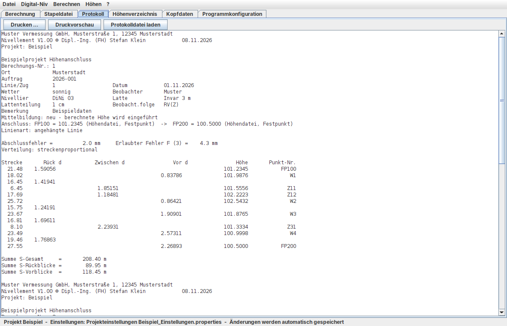

# Nivellement

**Nivellement V1.00 © Dipl.-Ing. (FH) Stefan Klein**

Klassische Auswertung geometrischer Nivellements **ohne Ausgleichung**: Der Abschlussfehler einer Nivellementlinie wird ermittelt, gegen eine Fehlergrenze geprüft und auf die Aufstellungen verteilt. Die Höhen werden in einer Projekt-Höhendatei mit Mittelbildung fortgeführt.

## ⬇ Download

**[Nivellement V1.00 für Windows herunterladen (ZIP, 36 MB)](https://github.com/htw9056/nivellement/releases/download/V1.00/Nivellement_V1.00_Windows.zip)**

So geht es los:

1. ZIP-Datei herunterladen und entpacken.
2. `Nivellement.exe` starten. Eine Java-Installation ist nicht nötig.
3. Meldet Windows beim ersten Start „Der Computer wurde durch Windows geschützt“, auf „Weitere Informationen“ und dann „Trotzdem ausführen“ klicken. Das Programm ist nicht digital signiert.

Alle Versionen und Änderungen stehen unter **[Releases](https://github.com/htw9056/nivellement/releases)**. Auf anderen Systemen startet man `app/Nivellement.jar` aus dem ZIP mit Java 17 oder neuer (`java -jar Nivellement.jar`).



**[Webseite](https://htw9056.github.io/nivellement/)** · **[Handbuch](https://htw9056.github.io/nivellement/Handbuch.html)**: ausführliche Anleitung mit Rechenweg und Formeln. Es ist auch im Programm unter *? → Handbuch* bzw. mit **F1** aufrufbar.

Weitere Ansichten: [Berechnung](docs/1_Berechnung.png) · [Stapeldatei](docs/2_Stapeldatei.png) · [Höhenverzeichnis](docs/4_Hoehenverzeichnis.png) · [Kopfdaten](docs/5_Kopfdaten.png) · [Programmkonfiguration](docs/6_Programmkonfiguration.png) · [Handbuch-Fenster](docs/7_Handbuch.png) · [Ausdruck](docs/8_Druck.png)

## Arbeitsablauf

Ein **Projekt** ist ein Ordner mit drei Dateien:

| Datei | Inhalt |
|---|---|
| `<Projekt>.NIG` | Stapeldatei mit allen Messdaten (Textdatei, ANSI) |
| `<Projekt>_Hoehen.csv` | Höhendatei |
| `<Projekt>_Protokoll.txt` | Berechnungsausgabe |

So wird ein Projekt ausgewertet:

1. **Neues Projekt** anlegen (*Datei → Neues Projekt*).
2. **Rohdaten übernehmen** (*Digital-Niv → Rohdaten (GSI / DAT) → Stapeldatei*).
   - Mehrere Dateien auf einmal sind möglich.
   - Jede Linie wird mit den Kopfdaten und Parametern aus dem Programm umformatiert und mit der nächsten freien Berechnungsnummer an die Stapeldatei angehängt.
   - Eine Anfangshöhe aus dem Gerät wird als Kommentarzeile `xH <Punkt> <Höhe>` mitgeführt.
3. **Stapeldatei bearbeiten** im Register *Stapeldatei*. Möglich sind z. B. diese Änderungen:
   - Kopfdaten und Punktnummern korrigieren
   - Mittelbildung je Punkt setzen: Kennung `D` durch `0`–`3` ersetzen
   - Zeilen ausblenden, indem man ein anderes Zeichen in Spalte 1 setzt
4. **Messdaten prüfen**: Aufbau, Reihenfolge r/z/v, Zahlen, Strecken, Unterbrechungen.
5. **Festpunkte** im Register *Höhenverzeichnis* eingeben oder importieren.
6. **Stapelberechnung** starten, für alle oder für Berechnungsnummer von–bis.
   - Das alte Protokoll wird gelöscht oder das neue angehängt.

GSI- und DAT-Dateien können auch direkt ohne Stapeldatei berechnet werden.

## Funktionen

### Eingabeformate

Das Format wird automatisch erkannt.

- **Leica GSI** (GSI-8 und GSI-16), z. B. DNA03, LS10/LS15, Sprinter
- **Trimble DAT** im Format M5 (DiNi), mit englischen (Rb/Rf/Rz/HD) und deutschen Kennungen (Lr/Lv/Lz/E, Zugbeginn/Zugende), auch mit Firstmessungen
- **Stapeldateien `.NIG`** (Format des früheren Programms NIGRA), damit vorhandene Projekte weiter ausgewertet werden können.
  - Kopfdaten, Parameter und punktspezifische Mittelbildung werden übernommen.

### Nivellement mit Zwischenblicken

- **Linienarten**
  - **Angehängte Linie** und **Schleife**
  - Fehlt ein Anschluss: Berechnung ohne Fehlerverteilung, bei bekanntem Endpunkt rückwärts.
  - Fehlen beide Anschlüsse, wird mit Anfangshöhe 0 gerechnet. Alle drei Fälle werden mit `***` gemeldet.
- **Abschlussfehler** w = Soll − Ist = (H_E − H_A) − Σdh
- **Verteilung**
  - streckenproportional: vᵢ = w · (s_R + s_V)ᵢ / Σs
  - oder nach Anzahl der Rück- und Vorblicke
- **Zwischenpunkte** erhalten den Anteil der Verbesserung ihrer Aufstellung bis zum Instrument: vᵢ · s_R / (s_R + s_V), bzw. vᵢ / 2 bei Verteilung nach Anzahl.
- **Doppelablesungen** (2 Lattenteilungen, RRVV, RVVR)
  - Mittelbildung der beiden Ablesungen
  - Differenz d = 1. − 2. Ablesung − Lattenkonstante in 0,1 mm
  - Standpunktdifferenz (R₁−R₂)−(V₁−V₂)
  - Markierung `***` bei Überschreitung der erlaubten Differenz
- **Lattenteilung** 1 cm oder ½ cm, **Lattenkonstante**

### Fehlergrenzen

- **Vier Fehlerklassen** mit frei definierbarer Formel in R (Messweg in km), z. B. `2 + 3*Sqrt(R)` oder `2 + 3*Sqrt(R/2)`.
  - Erlaubt sind `+ - * / ^`, Klammern, `Sqrt()` und `Abs()`.
- **Schwellfaktor**: Warnung schon bei einem Anteil der Fehlergrenze, z. B. 0,5.
- **Fehlerkennzeichnung**: alle Fehler mit `***`, Gesamtzahl am Ende der Berechnung.

### Höhendatei und Mittelbildung

Die Höhendatei `<Projekt>_Hoehen.csv` liegt im Ordner des Projekts und wird bei jeder Berechnung fortgeschrieben:

```
Punkt;Hoehe;BerNr;Diff_mm;AB;Datum;Bemerkung
```

- **Festpunkte** haben die Berechnungsnummer **999999** und werden nie verändert, nur verglichen. Zusätzlich kann eine Festpunktdatei (Punkt Höhe) angegeben werden.
- **Anschlusshöhen** werden in dieser Reihenfolge gesucht:
  1. manuelle Eingabe
  2. Festpunktdatei
  3. Höhendatei
  4. Messdatei (GSI WI 83 / DAT `Z`)
- **Mittelbildung**, je Linie oder bei `.NIG` auch je Punkt:
  - `0` **mitteln**: Mittel aus allen Bestimmungen
  - `1` **neu**: neue Höhe wird eingeführt
  - `2` **vergleichen**: alte Höhe bleibt
  - `3` **ohne**: kein Speichern, kein Vergleich
- **Mittelbildungsprotokoll** mit Höhendifferenz und Prüfung gegen die zulässige Differenz für Mehrfachbestimmungen.
- **Neupunkte vorher löschen**: Option, um ein Projekt sauber neu zu berechnen.
- **Übernahme aus NIGRA**:
  - Die Höhendatei (`.MDB`, Access 2000 und neuer) wird direkt gelesen, ohne Zusatzsoftware.
  - Ein Höhenverzeichnis im ASCII-Format (`.ASC`) wird mit allen Feldern übernommen.
  - Beim Öffnen eines Projekts ohne eigene Höhendatei wird der Import einer gleichnamigen `.MDB` angeboten.
- **Export** des Höhenverzeichnisses im ASCII-Format von NIGRA (3 oder 4 Dezimalstellen) oder als Punkt/Höhe.

### Rundung

Ausgaben werden vermessungstechnisch gerundet: Werte genau in der Mitte gehen auf die gerade Ziffer, z. B. 109.0625 → 109.062. Intern wird immer mit voller Stellenzahl gerechnet.

### Höhenverzeichnis

Die Höhendatei wird als Tabelle angezeigt, ist sortierbar und filterbar. Folgende Aktionen sind möglich:

- Punkte eingeben, ändern und löschen
- Punkte als Festpunkt markieren
- Umnummerieren:
  - ein einzelner Punkt
  - mehrere Punkte über eine Regel `alt=neu` für den Anfang der Punktnummer oder `+n` für numerische Nummern
- Import von ASCII-Dateien (Punkt Höhe), als Festpunkte oder Neupunkte
- Export als ASCII

### Protokoll

`<Messdatei>_Protokoll.txt` enthält je Berechnung:

- Kopf mit Firma, Projekt, Berechnungsnummer, Ort, Auftrag, Linie/Zug, Datum, Wetter, Beobachter, Nivellier, Latte, Lattenteilung, Beobachtungsfolge und Bemerkung
- Abschlussfehler und erlaubter Fehler F (Klasse)
- Feldbuch mit Strecke, Rück, d, Zwischen, d, Vor, d, Höhe und Punkt-Nr.
- Summen der Strecken

Am Ende stehen eine Gesamtmeldung (Summe aller Strecken, max. Abschlussfehler, Anzahl Fehler) und das Mittelbildungsprotokoll. Optional zeigt ein **erweitertes Protokoll** zusätzlich dh, Verbesserung je Punkt und die Probe ΣR − ΣV + Σv = H_E − H_A.

### Drucken

Protokoll, Stapeldatei und Höhenverzeichnis lassen sich drucken, mit Druckvorschau. Jede Seite (DIN A4) erhält einen Kopf mit Firma, Titel, Projekt und einem **eigenen Logo**, das in der Programmkonfiguration gewählt wird. In der Fußzeile stehen Programmversion, Datum und Seitenzahl. Jede Berechnung beginnt auf einer neuen Seite. Eine PDF-Datei entsteht über den Drucker „Microsoft Print to PDF“.

## Bedienung

### Windows-Paket

`Nivellement_Vx.xx_Windows.zip` entpacken und `Nivellement.exe` starten. Eine Java-Installation ist nicht nötig.

### Grafische Oberfläche

Doppelklick auf `Nivellement.jar` oder Aufruf `java -jar Nivellement.jar`. Die Oberfläche hat Menüs (Datei, Digital-Niv, Berechnen, Höhen) und sechs Register:

- **Berechnung**: Projekt, Rohdaten-Übernahme, Verteilung, Fehlerklasse, Mittelbildung, Stapelberechnung von–bis, Optionen
- **Stapeldatei**: Editor mit Spaltenlineal und Zeilen-/Spaltenanzeige
- **Protokoll**: Berechnungsausgabe
- **Höhenverzeichnis**: Höhendatei bearbeiten
- **Kopfdaten**: für die Umformatierung von Rohdaten und die direkte GSI/DAT-Berechnung
- **Programmkonfiguration**: Firma, Fehlerformeln der Klassen 1–4, Schwellfaktor, Grenze für Mehrfachbestimmungen

### Einstellungen

Alle Einstellungen, Auswahlen und Haken werden **automatisch gespeichert**, sobald sie geändert werden. Es gibt zwei Ebenen:

| Ebene | Datei | Inhalt |
|---|---|---|
| Programm | `~/.nivellement.properties` (Windows: `%USERPROFILE%`) | Programmkonfiguration (Firma, Fehlerklassen 1–4, Schwellfaktor, Grenze für Mehrfachbestimmungen, Logo), gilt für alle Projekte. Außerdem die zuletzt verwendeten Einstellungen, letztes Projekt, Fensterlage. |
| Projekt | `<Projekt>_Einstellungen.properties` neben der Stapeldatei | Alle Einstellungen des Projekts: Kopfdaten, Verteilung, Fehlerklasse, Mittelbildung, Dezimalstellen, Optionen, Festpunkt- und Höhendatei |

- **Neues Projekt:** Es übernimmt alle Einstellungen und Kopfdaten des zuletzt bearbeiteten Projekts. Ausgenommen sind Festpunkt- und Höhendatei.
- **Vorhandenes Projekt öffnen:** Seine eigenen Einstellungen werden wiederhergestellt.
- **NIGRA-Projekt ohne eigene Einstellungen:** Liegt eine `Projekt.xml` von NIGRA im Ordner, werden Fehlerklasse, Mittelbildung, Dezimalstellen, erlaubte Differenz, Verteilung und Kopfdaten daraus übernommen.
- **Nur im eigenen Projekt:** Manuelle Anfangs- und Endhöhe sowie Berechnungsnummer von–bis werden mit dem Projekt gespeichert, aber nicht in ein neues Projekt übernommen.
- **Statuszeile:** zeigt, woher die Einstellungen des aktuellen Projekts stammen.
- **Konsole:** verwendet ebenfalls die Projekteinstellungen. Optionen auf der Kommandozeile haben Vorrang.

### Konsole

```
java -jar Nivellement.jar <Messdatei .gsi|.dat|.nig> [Optionen]
  -f <Datei>   Festpunktdatei (je Zeile: Punkt Höhe)
  -hd <Datei>  Höhendatei (Standard: Hoehendatei.csv im Ordner der Messdatei)
  -v z|a       Verteilung streckenproportional (z) oder nach Anzahl der Blicke (a)
  -k 1..4      Fehlerklasse
  -m 0..3      Mittelbildung 0=mitteln 1=neu 2=vergleichen 3=ohne
  -n 2..5      Dezimalstellen der Höhen
  -ha <m>      Anfangshöhe manuell (erste Linie)
  -he <m>      Endhöhe manuell (erste Linie)
  -neu         Neupunkte vorher aus der Höhendatei löschen
  -x           erweitertes Protokoll
  -von <n> -bis <m>  nur Berechnungsnummern n bis m
  -a           Protokoll anhängen statt alte Berechnung löschen
  -p           Messdaten nur prüfen
  -u <Roh>     GSI/DAT umformatieren und an die Stapeldatei anhängen
  -mdb <Datei> NIGRA-Höhendatei (.MDB) übernehmen
  -asc <Datei> Höhenverzeichnis (ASCII, NIGRA-Format) übernehmen
  -export <Datei>  Höhenverzeichnis als ASCII (NIGRA-Format) ausgeben
```

Beispiel:

```
java -jar Nivellement.jar Projekt.nig -u Linie1.gsi
java -jar Nivellement.jar Projekt.nig -f Festpunkte.txt
```

## Beispieldaten

Im Ordner `beispiele/` liegen:

- `Beispiel_Linie_angehaengt.gsi`: GSI-16, angehängte Linie FP100 → FP200 mit Zwischenblicken
- `Beispiel_Schleife.dat`: Trimble DAT M5, Schleife ab FP100 in RVVR mit Zwischenblick
- `Festpunkte.txt`

## Unterstützte Datenelemente

**Leica GSI**

| WI | Bedeutung |
|---|---|
| 11 | Punktnummer |
| 32 | Zielweite |
| 331 / 335 | Rückblick (1. / 2. Ablesung) |
| 332 / 336 | Vorblick (1. / 2. Ablesung) |
| 333 | Zwischenblick |
| 83 | Höhe |
| 41 / 42 | Linienbeginn / Linienname |

**Trimble DAT (M5)**

| Kennung | Bedeutung |
|---|---|
| `KD1`/`KD2` | Punktnummer |
| `Rb` | Rückblick |
| `Rf` | Vorblick |
| `Rz` | Zwischenblick |
| `HD` | Zielweite |
| `Z` | Höhe |
| `Start-Line` / `End-Line` | Linientrennung |

**Stapeldatei .NIG**

| Kennung | Bedeutung |
|---|---|
| `C` | Titel |
| `B` | Berechnungsnummer |
| `K` | 12 Kopf- und 8 Parameterzeilen |
| `E` | Mittelbildung / Fehlerklasse / Einheit |
| `D`, `0`–`3` | Messdaten mit `r`/`z`/`v` |

## Prüfung

Die Rechenweise wurde gegen NIGRA 6.2 geprüft:

- mit den Beispielen des NIGRA-Handbuchs
- mit zwei realen Projekten: 24 Nivellements mit über 500 Punkthöhen
  - Höhen, Abschlussfehler, Fehlergrenzen, Mittelbildung und Höhendatei stimmen überein.
  - Das gilt auch für die direkte Umformatierung der Trimble-DAT-Rohdaten.

## Geplant

- Streckennivellement, Linienausgleichung, Instrumentenprüfung
- Rückschreiben der Höhen ins Geräteformat
- Setzungslisten und -diagramme, Profile
- Lattenkorrektur (Lattenmeter, Temperatur)

## Entwicklung

- Java 17 oder neuer, Eclipse-Projekt: *File → Import → Existing Projects into Workspace*
- Keine externen Bibliotheken
- JAR bauen: `bauen.bat` (Windows) bzw. `bauen.sh`
- Windows-Programm mit eingebetteter Java-Laufzeit:
  - unter Windows: `exe_bauen.bat` (benötigt JDK 17+ mit jpackage)
  - unter Linux: `windows/paket_bauen.sh <Linux-JDK> <Windows-JDK>`
    - erzeugt `Nivellement.exe` (Oberfläche) und `NivellementKonsole.exe`
    - mit Symbol und Versionsinformation
    - mit einer per `jlink` verkleinerten Java-Laufzeit (ca. 50 MB)
    - benötigt Go und Python 3

## Lizenz

MIT-Lizenz, siehe [LICENSE](LICENSE).

Das Windows-Paket enthält zusätzlich die Java-Laufzeit Eclipse Temurin (GPLv2 mit Classpath Exception) und Teile der Go-Standardbibliothek (BSD-Lizenz), siehe [windows/DRITTANBIETER.txt](windows/DRITTANBIETER.txt).

## Hinweis zu NIGRA

Nivellement ist ein eigenständiges, unabhängig entwickeltes Programm. Arbeitsweise und Dateiformate orientieren sich an dem nicht mehr vertriebenen Programm NIGRA, damit vorhandene Projekte weiter bearbeitet werden können. Es enthält aber keinen Programmcode und keine Texte von NIGRA. NIGRA ist ein Produkt von Kurt Andrä. Der Name wird nur verwendet, um die Kompatibilität zu beschreiben. Es besteht keine Verbindung zu Kurt Andrä.
